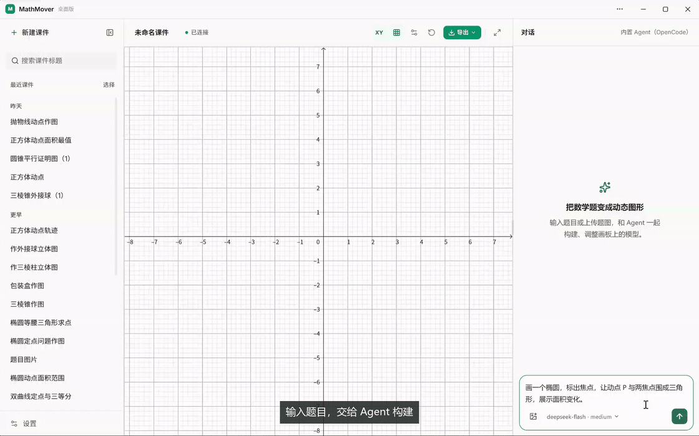
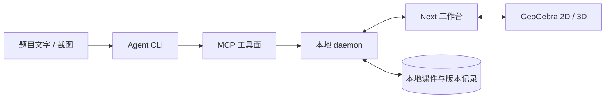

<div align="center">
  

  # MathMover

  **把数学题目变成可以拖动、可以观察、也可以继续修改的 GeoGebra 图形。**

  [](https://github.com/Derek-yyang/mathmover/releases/latest)
  
  
  
  

  [下载 Windows 版](https://github.com/Derek-yyang/mathmover/releases/latest/download/MathMover-Setup.exe) ·
  [查看 Releases](https://github.com/Derek-yyang/mathmover/releases) ·
  [提交问题](https://github.com/Derek-yyang/mathmover/issues)
</div>



<sub>演示自动循环，共 23.8 秒。Agent 构建过程的等待片段已加速，最后的拖动探索保持原速。需要更清晰的画面，可[下载 MP4 视频](https://github.com/Derek-yyang/mathmover/raw/refs/heads/master/docs/assets/mathmover-demo.mp4)。</sub>

## MathMover 是什么

MathMover 是一个面向中学数学的桌面工作台。输入题目文字或截图后，Agent 会通过 MCP 工具在 GeoGebra 画布上逐步构建图形。图形不是一张静态结果图：你可以拖动点、改变参数，也可以继续让 Agent 修改当前画面。

演示里的题目是“画一个椭圆，标出焦点，让动点 P 与两焦点围成三角形，展示面积变化”。Agent 会读取画布、添加构造、检查对象状态，再把结果交还给你操作。

## 能做什么

- **边构建边查看**：Agent 每完成一段构造就调用一次 `ggb_apply`，图形会逐步出现在画布上。
- **GeoGebra 2D / 3D**：覆盖函数与图像、平面几何、解析几何、立体几何四类题目。
- **修改现有图形**：Agent 可以先读取对象、滑块和画布截图，再针对当前结果继续修改。
- **本机优先**：daemon 只监听 `127.0.0.1`，模型密钥、课件和版本记录都保存在本机。
- **接入自己的 Agent**：桌面端内置 OpenCode，也可以选择本机已经安装的 Claude Code、Codex 或 dsh。
- **使用自己的模型 API**：在设置中填写接口格式、API 端点、密钥和模型；请求直接发往你选择的模型服务。

## 下载

目前提供 Windows x64 安装包：

**[下载最新版 MathMover](https://github.com/Derek-yyang/mathmover/releases/latest/download/MathMover-Setup.exe)**

安装器默认创建开始菜单和桌面快捷方式，安装时可以取消桌面快捷方式选项。应用默认安装在 `%LOCALAPPDATA%\Programs\MathMover`，课件、设置、日志和更新缓存放在 `%LOCALAPPDATA%\MathMover`，卸载应用不会删除这些用户数据。

当前安装包没有代码签名，Windows 可能显示“未知发布者”。如果确认文件来自本仓库的 Releases，可以点击“更多信息”后继续运行。

第一次启动会打开设置。你可以选择：

1. 连接模型 API，填写接口格式、端点、密钥和模型名；
2. 使用本机已经安装并登录的 Agent；
3. 使用桌面端内置的 OpenCode，并自行配置模型端点。

MathMover 不提供共享模型额度。API 或 Agent 产生的费用由对应服务商收取。

## 从源码运行

需要 Node.js 24 或更高版本、npm，以及 Windows 10/11 x64。

```powershell
git clone https://github.com/Derek-yyang/mathmover.git
cd mathmover

npm ci

cd math-mover-next
npm ci
npm run ggb:install

cd ..\desktop
npm ci
npm run dev
```

`npm run dev` 会先准备 Next、daemon 和 GeoGebra 资产，再启动 Electron。第一次构建需要下载 Electron、Node 运行时和 GeoGebra 资源，耗时会比后续启动长。

构建安装包：

```powershell
cd desktop
npm run dist
```

产物位于 `desktop/release/`。发布流程由 `.github/workflows/desktop-release.yml` 完成；新版本会同时上传版本化安装包和固定文件名 `MathMover-Setup.exe`，首页和 README 里的下载链接不需要随版本修改。

## 工作方式



LLM 负责理解题意和安排构造顺序，具体几何对象由 GeoGebra 执行。daemon 把 Agent 的工具调用转成画布操作，并把对象清单、滑块状态和截图返回给 Agent。这样，Agent 能看见自己刚刚画出的结果，再决定下一步。

当前 MCP 工具包括：

- `ggb_get_state`：读取画布对象、滑块、体检结果和截图；
- `ggb_apply`：把工作稿应用到画布，返回差异与构造问题；
- `ggb_reset`：清空画布和工作稿；
- `get_expert_prompt`：按题目类别获取对应的建模流程；
- `get_sop_cards`：按需读取具体写法卡。

## 目录

```text
math-mover-next/         Next 工作台与产品首页
packages/agent-runtime/  Claude Code、Codex、dsh、OpenCode 的运行时适配
packages/ggb-core/       GeoGebra 命令目录、SOP、校验与语义检查
packages/daemon/         本地 daemon、WebSocket、MCP 工具面与课件存储
desktop/                 Electron 桌面壳、安装器与自动更新
skills/                  四类数学题目的建模知识和写法卡
ggb_commands.json        GeoGebra 命令目录
docs/assets/             README 演示动图、视频与封面
```

## 数据与隐私

MathMover 当前没有线上工作台，也不需要 MathMover 账号。模型请求由桌面端直接发往你配置的 API 服务或本机 Agent。

以下内容保存在 `%LOCALAPPDATA%\MathMover`：

- 模型与 Agent 设置；
- 本地课件和修改版本；
- daemon、Next 与桌面端日志；
- Electron 缓存和窗口状态。

提交问题前，可以用应用菜单里的“复制诊断信息”生成环境摘要。分享日志或截图前，请先检查其中是否包含题目内容、接口地址或密钥。

## 已知限制

- 当前只验证了 Windows x64；macOS 和 Linux 还没有正式安装包。
- 安装包尚未签名，可能触发 Windows SmartScreen 提示。
- 内置 OpenCode 不需要额外安装，但仍需配置可用的模型 API。
- 外部 Claude Code、Codex 和 dsh 需要用户自行安装并登录。
- GeoGebra 资源会随桌面端一起打包，因此安装包体积较大。
- 生成质量仍取决于题目、Agent、模型和 SOP。复杂题可能需要继续对话修改。

## 常见问题

**需要另外安装 GeoGebra 吗？**

使用桌面安装包时不需要。从源码运行前端时，先执行 `npm run ggb:install`。

**生成的只是图片吗？**

不是。MathMover 生成的是 GeoGebra 构造，点、线、滑块和依赖关系都可以继续操作。

**能直接在线使用吗？**

当前版本统一通过桌面端运行。产品首页只用于介绍、演示和下载。

**模型 API 密钥放在哪里？**

保存在本机应用数据目录。界面只显示密钥末尾几位，重新保存时留空表示不替换原密钥。

**换电脑后课件还在吗？**

课件保存在本机，不会自动同步到云端。迁移前需要备份 `%LOCALAPPDATA%\MathMover` 中对应的数据。

## 开发与反馈

运行工作区测试：

```powershell
npm test
```

提交 bug 时，最好附上：

- MathMover 版本和 Windows 版本；
- 使用的 Agent 与模型；
- 原始题目或截图；
- 预期结果、实际结果和相关日志。

功能建议和问题都可以发到 [Issues](https://github.com/Derek-yyang/mathmover/issues)。

## 致谢

MathMover 建立在 [GeoGebra](https://www.geogebra.org/)、[Model Context Protocol](https://modelcontextprotocol.io/)、[OpenCode](https://opencode.ai/)、[Claude Code](https://www.anthropic.com/claude-code)、[Codex](https://openai.com/codex/) 和 [Next.js](https://nextjs.org/) 之上。

## License

MathMover 的原创源代码采用 [MIT License](./LICENSE)，Copyright (c) 2026 Derek Yang。`packages/dsh-runtime` 中包含来自 DeepSeek Harness 的上游代码，该部分继续适用 Apache-2.0。

GeoGebra、Electron、OpenCode 及其他第三方组件继续适用各自的许可证。尤其是 GeoGebra，其应用目前仅允许免费用于非商业用途，商业使用需要单独取得授权。详见 [Third-party notices](./THIRD_PARTY_NOTICES.md)。
